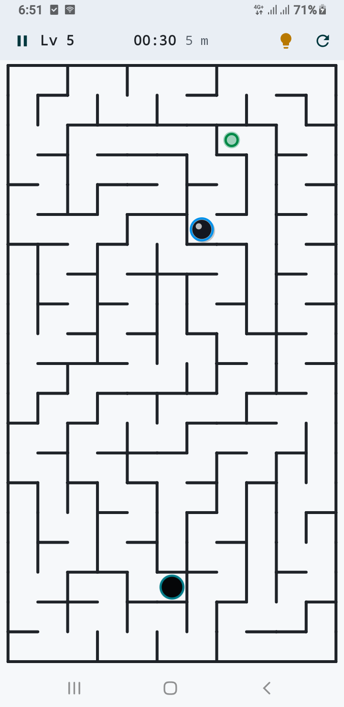

# AS Maze

A small, offline maze puzzle game for Android, built with **Kotlin** and **Jetpack Compose**. Every level is generated procedurally, scales to your screen size, and adds new mechanics as you progress: fog of war, keys and doors, portals and patrolling hazards.


## 🎬 App Demo

<p align="center">
  <a href="https://youtube.com/shorts/mBite0BMolQ">
    
  </a>
</p>
*Click the screenshot above to watch the app in action on YouTube.*

---

## Features

- **200 levels** across four difficulty tiers: Easy, Medium, Hard and Expert.
- **Procedural mazes** using three algorithms (Recursive Backtracker, Prim, Kruskal), with quality checks and deterministic seeds so a level is always reproducible.
- **Level mechanics** that are introduced gradually:
  - Fog of war with explored-area memory
  - Key and locked door
  - Linked portals
  - Moving hazards that reset you to the start
  - Braid mazes (loops instead of pure dead ends)
- **Daily Challenge:** a new fog-and-braid maze every day, with a best-time record.
- **Two control schemes:** swipe-to-slide or finger drag.
- **Star rating** based on moves and time, measured against the optimal solution found by BFS.
- **Hints:** a limited number per level, shown as a path preview.
- **Adaptive layout:** the grid is sized from the available screen area, so cells never get smaller than 16dp.
- **Polish:** runtime-generated retro sound effects, haptic feedback, light/dark/system theme, edge-to-edge UI, auto-pause when the app is backgrounded.
- **Fully offline.** No ads, no network, no accounts.

## Tech stack

| Area | Choice |
|------|--------|
| Language | Kotlin |
| UI | Jetpack Compose, Material 3, Canvas rendering for the maze |
| Architecture | MVVM with unidirectional data flow (`UiState` + `UiAction`), clean layering |
| Async | Kotlin Coroutines and Flow |
| Persistence | Room (level progress, daily challenge) and DataStore Preferences (settings) |
| Navigation | Navigation Compose |
| DI | Lightweight manual container (`AppContainer`) |
| Audio / haptics | `SoundPool` with generated WAV tones, `Vibrator` / `VibrationEffect` |

## Project structure

```
com.example
├── AsApplication.kt, MainActivity.kt
├── di/                  Manual dependency container
├── data/
│   ├── db/              Room database, DAOs, entities
│   ├── preferences/     DataStore settings
│   ├── repository/      GameRepository (single source of truth)
│   ├── sound/           Procedural sound effects
│   └── haptics/         Haptic feedback
├── domain/
│   ├── generator/       Maze generation (Backtracker, Prim, Kruskal, braid)
│   ├── solver/          BFS solver, swipe-move simulator, optimal move count
│   ├── model/           Maze, Cell, Difficulty, mechanics, grid sizing
│   └── scoring/         Star and score calculation
└── ui/
    ├── game/            GameScreen, GameViewModel, MazeCanvas, dialogs
    ├── home/  levels/  settings/  howtoplay/
    ├── navigation/      Routes
    └── theme/           Colors, typography, light/dark themes
```

### How it works

- **Generation:** `MazeGenerator` builds a perfect maze, picks start and end with a double-BFS (longest path), optionally braids it, then places mechanics. Each candidate is validated with a multi-state BFS (position + has-key) so every level is solvable.
- **Movement rules:** `SlideSimulator` is the single source of truth for swipe movement. The ViewModel and the optimal-move solver both use it, so star ratings always match what a player can really do.
- **Rendering:** `MazeCanvas` splits drawing into a cached static layer (walls) and a lightweight dynamic layer (ball, fog, hazards), which keeps animations smooth on large grids.

## Getting started

### Requirements

- Android Studio (latest stable)
- JDK 17 or newer (matching your Gradle / AGP setup)
- Android 7.0 (API 24) or higher device or emulator

## How to play

1. Guide the ball from the green start marker to the glowing goal.
2. **Swipe** to slide until the next decision point, or switch to **Drag** mode in Settings.
3. Grab the golden key to open the red gate, step into purple portals to teleport, and avoid red patrols.
4. Finish with fewer moves and less time to earn up to three stars.

